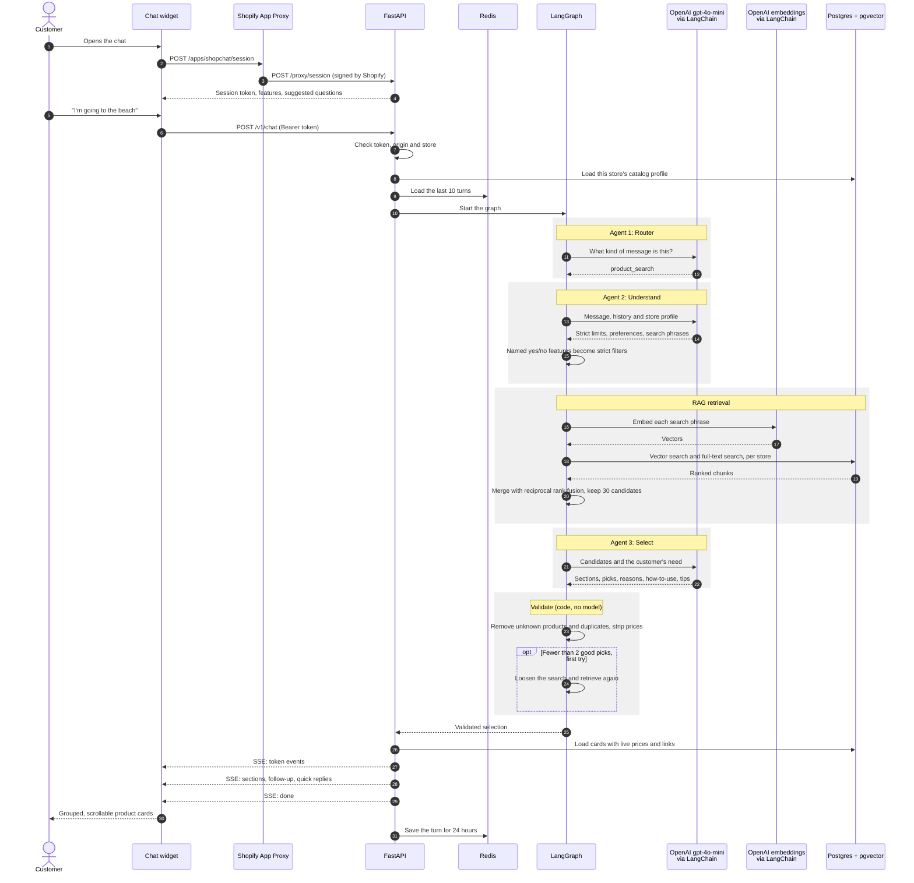

# MentePilot

A public, multi-store Shopify app that adds a shopping assistant to any storefront. Customers
describe what they need in their own words, such as a trip to the beach, oily skin, a birthday or
a budget. The assistant answers only with real products from that store.

**New here?** Follow [docs/local-setup.md](docs/local-setup.md). It covers every command, step by
step, to run the chatbot on your own computer with Docker and no Shopify store.

## How a message is answered



The graph, retrieval, image and error paths are in [docs/request-flow.md](docs/request-flow.md).

## Features

- Understands situations, weather, occasions, skin and hair concerns, budgets and product names.
- Works for any kind of store, because each store gets its own generated catalog profile.
- Hybrid RAG: pgvector search and full-text search combined.
- A multi-agent LangGraph flow: router, planner, selector and code validation.
- Grouped answers with product cards, how-to-use and tips sections, and routines as steps.
- Conversation memory across pages, follow-up questions and quick replies.
- Image upload, and consent-based skin analysis.
- Voice input and spoken replies, built but switched off by default.
- Each store's data is separated by Postgres row-level security.
- Automatic catalog sync through Shopify webhooks.

## Repository layout

```text
.
├── backend/                 Python service
│   ├── src/shopchat/        API, agents, search, catalog, chat, LLM, Shopify, worker
│   ├── migrations/          Alembic migrations
│   ├── evals/               The 52-question quality check
│   ├── scripts/             Terminal tools
│   ├── tests/               Unit and integration tests
│   └── Dockerfile
├── frontend/
│   ├── extensions/chat-widget/   Storefront widget (Theme App Extension)
│   ├── admin/                    Merchant page inside Shopify admin
│   ├── tests/widget/             Widget tests
│   └── shopify.app.toml.example  Shopify app configuration template
├── db/seed/                 Demo catalog dump with embeddings
├── frontend/dev/            Local page for trying the chat without Shopify
├── docs/                    Documentation
├── docker-compose.yml       All services
└── docker-compose.dev.yml   Development only: /dev page and live reload
```

## Quick start with Docker

You need Docker. The seed loads 1,000 indexed products, so no embedding cost is needed to start.

```bash
cp backend/.env.example backend/.env
docker compose up -d --build
curl http://localhost:8000/healthz
```

Compose runs the migrations and loads `db/seed/shopchat_seed.dump` into an empty database.

To ask the demo store a question, add `OPENAI_API_KEY` and the model names to `backend/.env`, then:

```bash
docker compose run --rm -e LLM_CALLS_ENABLED=true api \
  uv run --no-sync python scripts/ask.py "I'm going to the beach"
```

## Local development

The full guide, with Docker installation, dumps, restores and troubleshooting, is
[docs/local-setup.md](docs/local-setup.md). To run the backend outside Docker, you need Python 3.12,
[uv](https://docs.astral.sh/uv/) and Node.js 20 or later.

```bash
docker compose up -d postgres redis

cd backend
cp .env.example .env
uv sync
uv run alembic upgrade head
(cd .. && docker compose run --rm --no-deps seed)   # Load the seed into the empty database
uv run uvicorn shopchat.api.app:app --reload
uv run arq shopchat.worker.main.WorkerSettings   # In a second terminal

cd ../frontend
npm ci
npm test
```

## Try the chatbot without Shopify

Development mode serves a placeholder shop page with the real chat widget on it. The widget talks
to your local database (the seeded `cosmo-genie.myshopify.com` catalog by default), and its header
has a maximize button that the storefront does not show.

With Docker, one command starts everything in development mode:

```bash
docker compose -f docker-compose.yml -f docker-compose.dev.yml up -d --build
```

Outside Docker:

```bash
cd backend
DEV_MODE=true uv run uvicorn shopchat.api.app:app --reload
```

Open <http://localhost:8000/dev>. `WIDGET_TOKEN_SECRET` must be set in `backend/.env`. Both commands
make no OpenAI calls, so the chat opens but cannot answer. To get answers, put
`LLM_CALLS_ENABLED=true` in front of either command and set `OPENAI_API_KEY`; every question is
then a paid call.

- `DEV_SHOP_DOMAIN` picks another indexed store.
- The widget files load straight from `frontend/extensions/chat-widget/assets`, so edits show on
  refresh with no Shopify deploy. In Docker, Python edits also restart the server.
- With `DEV_MODE` off, every `/dev` address answers 404. With it on, they still answer only this
  machine or a private network: requests through a tunnel such as ngrok get 404.

Every step is in [docs/local-setup.md](docs/local-setup.md).

## Connect a real store

Follow [docs/shopify-setup.md](docs/shopify-setup.md).

## Paid API calls

`LLM_CALLS_ENABLED` is off by default, and nothing can reach OpenAI while it is off. Turn it on for
real chat and for indexing. Tests never call OpenAI.

## Tests

```bash
cd backend && uv run pytest && uv run ruff check . && uv run mypy src evals
cd frontend && npm test && npm run lint
```

## Current quality

The latest run of the 52-question check, on the full 1,000-product store with `gpt-4o-mini`:

| Measure | Result | Target |
| --- | --- | --- |
| Relevant in the top 5 | 75% | 80% |
| Fact violations | 5 | 0 |
| Invented products | 0 | 0 |
| Replies containing a price | 0 | 0 |

The 80% target has not been reached yet. Every question and answer is in
[docs/evaluation-results.md](docs/evaluation-results.md).

## Documentation

| Document | Contents |
| --- | --- |
| [Local setup](docs/local-setup.md) | Every command, step by step, to run it locally with Docker and no Shopify store |
| [Architecture](docs/architecture.md) | Components, design decisions, technology |
| [Request flow](docs/request-flow.md) | The agent graph, retrieval, text and image sequences |
| [Indexing](docs/indexing.md) | Catalog pipeline, first install, webhooks, facts |
| [API reference](docs/api.md) | Every endpoint with requests and responses |
| [Database](docs/database.md) | Schema diagram, row-level security, Redis keys |
| [Seed data](docs/seed-data.md) | What the dump contains and how to load or rebuild it |
| [Configuration](docs/configuration.md) | Every setting |
| [Shopify setup](docs/shopify-setup.md) | Connecting a store |
| [Deployment](docs/deployment.md) | Docker services and production checklist |
| [Testing](docs/testing.md) | Running tests and checks |
| [Evaluation](docs/evaluation.md) | How the 52-question check works |
| [Evaluation results](docs/evaluation-results.md) | Every question and answer from the latest run |
| [Security](docs/security.md) | Protections and privacy |
| [Design spec](docs/superpowers/specs/2026-11-08-shopify-product-chatbot-design.md) | The original design |
