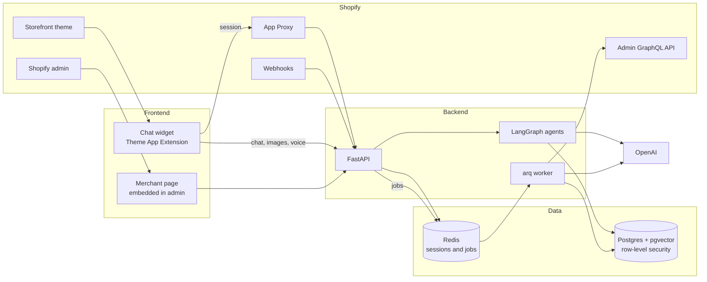

# Architecture

To run the project on your own computer, follow [Local setup](local-setup.md).

MentePilot is a public, multi-store Shopify app. A shopper describes a need in plain language and
the assistant answers only with products from that store's own catalog.

## System overview

## Components

| Part | Location | Job |
| --- | --- | --- |
| Chat widget | `frontend/extensions/chat-widget` | Storefront panel, written in plain JavaScript with no framework |
| Merchant page | `frontend/admin` | Index status, usage and feature switches inside Shopify admin |
| HTTP API | `backend/src/shopchat/api` | OAuth, App Proxy, widget endpoints, webhooks, merchant API |
| Agents | `backend/src/shopchat/agents` | The LangGraph flow that answers a message |
| Search | `backend/src/shopchat/search` | Hybrid retrieval, filters and product cards |
| Catalog | `backend/src/shopchat/catalog` | Reads products, extracts facts, builds the RAG index and store profile |
| Chat | `backend/src/shopchat/chat` | Runs one turn, keeps short-lived memory, records usage |
| LLM | `backend/src/shopchat/llm` | Provider-independent interfaces and the OpenAI implementation |
| Shopify | `backend/src/shopchat/shopify` | Signatures, OAuth, token refresh and the GraphQL client |
| Worker | `backend/src/shopchat/worker` | Imports and webhook jobs |

## Design decisions

- **Works for any store.** Nothing is hard-coded to cosmetics. A catalog profile, generated per
  store, tells the agents that store's vocabulary, categories, price range and facets.
- **The model cannot invent products.** It may only choose IDs from the retrieved candidates, and
  `validate_selection` removes anything else in code.
- **The model never quotes prices.** The validator strips money from its text, and the cards read
  prices from the database.
- **Facts carry provenance.** Each fact is `stated` by the merchant or `inferred` by the model.
  Only `stated` facts can be strict filters.
- **Facts the code can enforce are not left to the model.** A yes/no feature the customer names
  outright, such as "waterproof", always becomes a strict filter.
- **Store isolation is in the database.** Row-level security limits every query to one store.
- **Paid calls have a hard switch.** Nothing reaches OpenAI while `LLM_CALLS_ENABLED` is false.
- **The bot recommends only.** It has no cart or checkout actions.

## Technology

| Area | Choice |
| --- | --- |
| Backend | Python 3.12, FastAPI, SSE, SQLAlchemy 2 (async), Alembic, arq |
| Orchestration | LangGraph `StateGraph` |
| Model access | LangChain `ChatOpenAI` and `OpenAIEmbeddings`; the OpenAI SDK for speech |
| Models | `gpt-4o-mini` (chat), `text-embedding-3-small` (1536 dimensions) |
| Data | Postgres 16, pgvector HNSW, full-text search, Redis 7 |
| Frontend | Vanilla ES modules, Shopify Theme App Extension |
| Quality | pytest, ruff, mypy `--strict`, node:test with jsdom, ESLint, Prettier |
