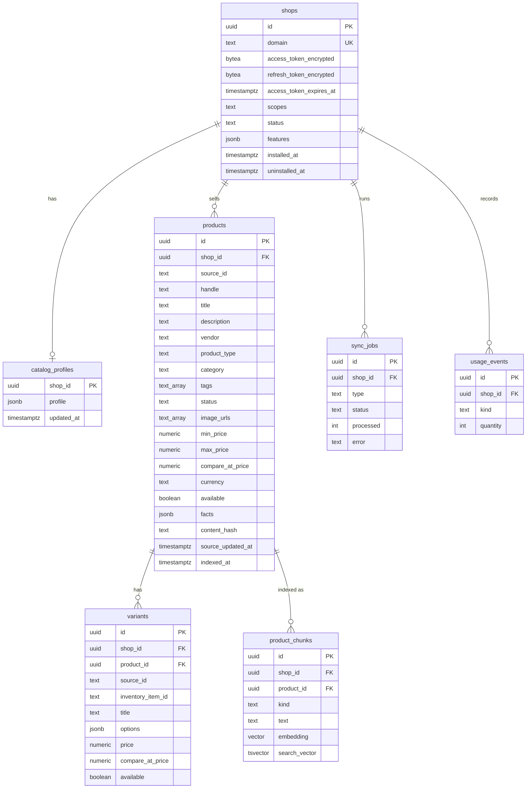

# Database

Postgres 16 with the pgvector extension. Migrations are in `backend/migrations`.



## Store isolation

| Role | Used by | Rights |
| --- | --- | --- |
| `shopchat_owner` | Migrations and seeding | Owns the schema |
| `shopchat_app` | API and worker | Data access only, cannot bypass row-level security |

Every table except `shops` has the `shop_isolation` policy, with `FORCE ROW LEVEL SECURITY`:

```sql
USING (shop_id = NULLIF(current_setting('app.shop_id', true), '')::uuid)
```

`session_for_shop(shop_id)` sets `app.shop_id` for one transaction. A query with no store context
returns no rows, so a forgotten filter cannot leak another store's data.

## Redis

| Key | Holds | Lifetime |
| --- | --- | --- |
| `chat:{shop_id}:{session_id}` | Last 10 turns | 24 hours |
| arq keys | Background jobs | Managed by arq |

## Migrations

| Revision | Change |
| --- | --- |
| `0001_initial` | Schema, roles, row-level security, HNSW and full-text indexes |
| `0002_expiring_tokens` | Refresh token and expiry for Shopify expiring tokens |
| `0003_product_indexed_at` | When each product was last indexed |
