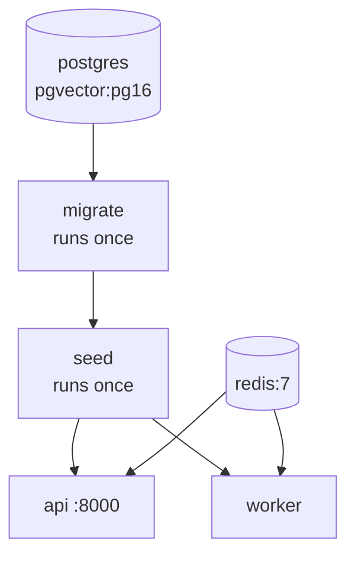

# Deployment

To run the project on your own computer, follow [Local setup](local-setup.md).

The whole stack runs from `docker-compose.yml`.



| Service | Image | Job |
| --- | --- | --- |
| `postgres` | `pgvector/pgvector:pg16` | Database |
| `redis` | `redis:7` | Sessions and jobs |
| `migrate` | Backend image | `alembic upgrade head`, then exits |
| `seed` | `pgvector/pgvector:pg16` | Loads the demo catalog if the database is empty, then exits |
| `api` | Backend image | FastAPI on port 8000 |
| `worker` | Backend image | Background jobs |

The backend image is built from the repository root, because the API also serves `frontend/admin`.

## Production checklist

- Replace the default database passwords in `docker-compose.yml`, and set `SHOPCHAT_APP_PASSWORD`.
- Do not publish the Postgres or Redis ports.
- Put the API behind HTTPS and set `APP_URL` to that address.
- Keep `TOKEN_ENCRYPTION_KEY` stable: changing it makes stored tokens unreadable.
- Remove the `seed` service, so a customer environment never contains demo data.
- Set `LLM_CALLS_ENABLED=true` on both `api` and `worker`, or product updates are not indexed.
- Add per-store usage limits before accepting public traffic.
- Back up Postgres.

## Useful commands

```bash
docker compose logs -f api
docker compose run --rm api uv run --no-sync alembic current
docker compose down        # Stop and keep data
docker compose down -v     # Stop and delete data, including the seed
```
