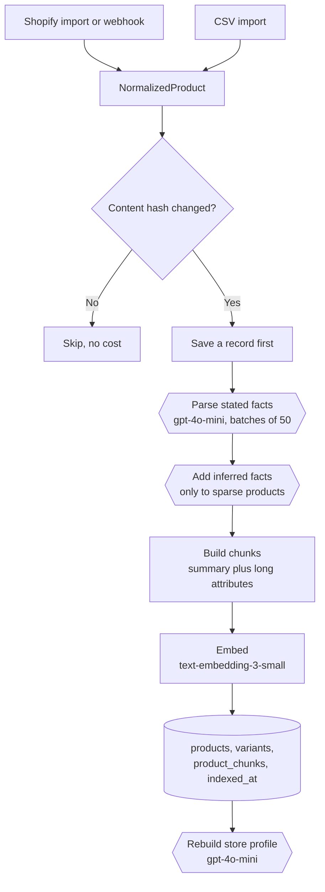
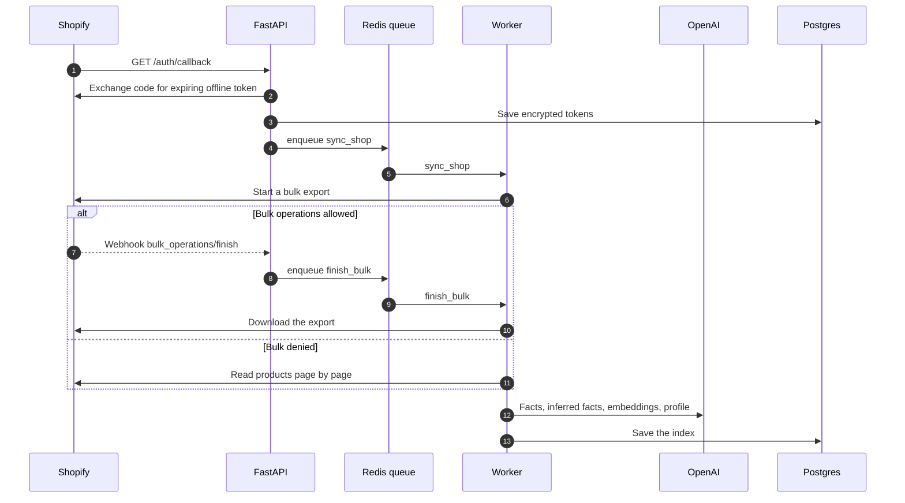

# Catalog indexing

Every product, from any source, goes through `run_catalog_pipeline` in
`backend/src/shopchat/catalog/pipeline.py`.



Progress is saved every 100 products, so a retry resumes instead of paying twice.

## First install



## Keeping the index current

| Webhook | Job | Effect |
| --- | --- | --- |
| `products/create`, `products/update` | `upsert_product` | Re-index if the content hash changed |
| `products/delete` | `delete_product` | Remove the product and its chunks |
| `inventory_levels/update` | `update_inventory` | Update availability without a model call |
| `bulk_operations/finish` | `finish_bulk` | Index the finished export |
| `app/uninstalled` | `deactivate_shop` | Mark the store inactive |
| `shop/redact` | `redact_shop` | Delete the store's data |
| `customers/data_request`, `customers/redact` | none | Acknowledged; no customer data is stored |

Jobs retry up to 5 times with backoff. Webhooks are verified by HMAC before anything is queued.

## Facts

A fact has a value, a provenance and an optional caveat.

```json
{ "waterproof": { "value": true, "provenance": "stated", "caveat": null } }
```

- Only `stated` yes/no and number facts can be strict filters.
- A negation guard stops text like "not waterproof" from becoming `true`.
- Inferred facts are shown as "likely" and are never used as strict filters.
