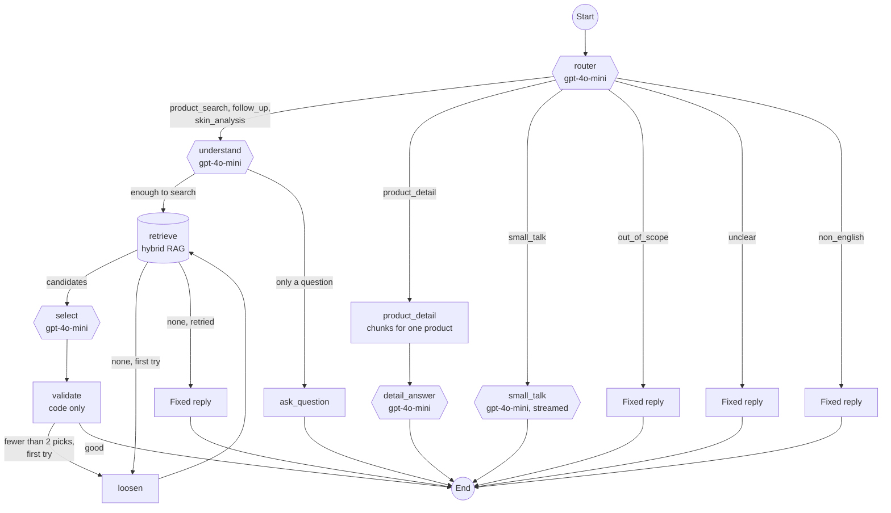
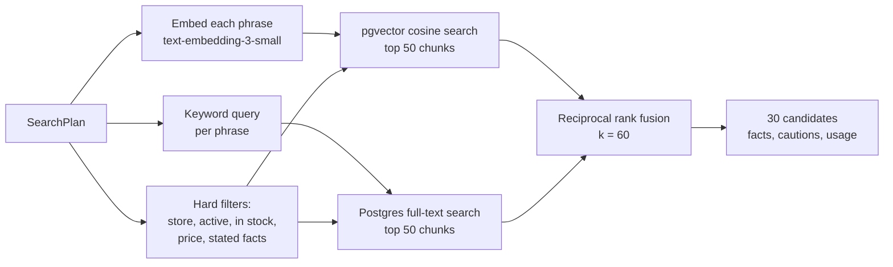
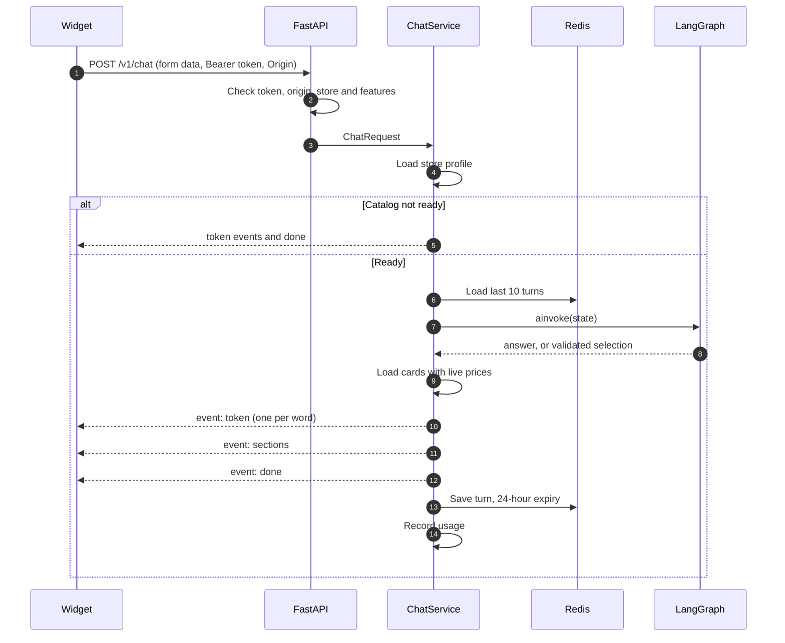
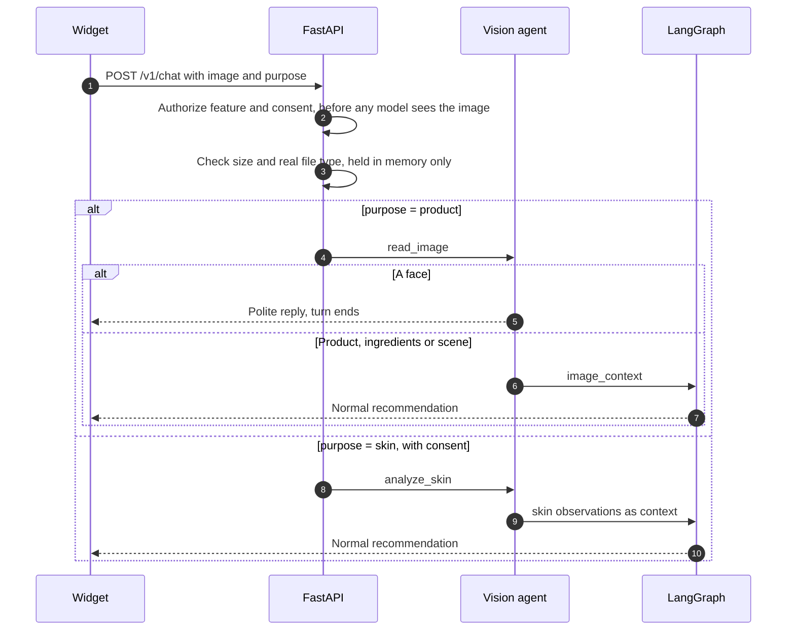

# Request flow

What happens from the moment a customer presses send. The README has the end-to-end sequence
diagram. This page covers each stage in more detail.

## The agent graph

Defined in `backend/src/shopchat/agents/graph.py`.

Hexagons call a model. Rectangles run code only.

## What each agent does

| Node | Input | Output | Model |
| --- | --- | --- | --- |
| `router` | Message and recent history | One of 8 intents, plus a focus product | Yes |
| `understand` | Message, history, store profile | `SearchPlan`: firm limits, soft preferences, 2 to 4 search phrases | Yes |
| `retrieve` | `SearchPlan` | Up to 30 candidate products | Embeddings only |
| `select` | Candidates, message, history | Up to 4 sections of up to 5 products with reasons, how-to-use and tips | Yes |
| `validate` | Selection and candidates | Cleaned selection | No |
| `loosen` | Current plan | Broader plan; price limits stay, facts go only if nothing matched | No |
| `product_detail` | Focus product and question | Most relevant chunks of that product | Embeddings only |
| `detail_answer` | Those chunks | An answer grounded in them | Yes |
| `small_talk` | Message | A short reply | Yes |

## Retrieval

HNSW iterative scan is switched on, so filtered vector searches still return enough rows.

## Text chat

## Image upload

Photos are never written to disk or stored.

## Replies that never call a model

| Situation | Reply comes from |
| --- | --- |
| Catalog still being prepared | `PREPARING_REPLY` in `chat/service.py` |
| Out of scope, unclear, or not English | `agents/answers.py` |
| Nothing matched after loosening | `NO_MATCH_REPLY` in `agents/answers.py` |
| Any exception | `TRY_AGAIN_REPLY`; only the error type is logged |
